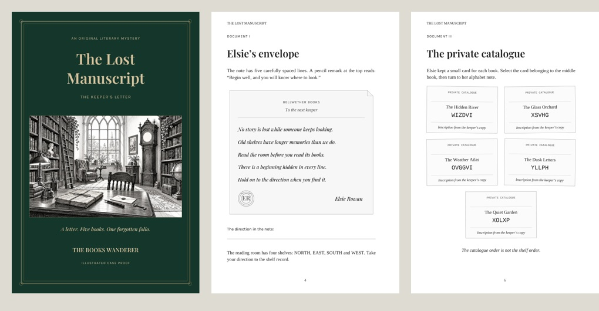

# The Lost Manuscript — maqueta editorial ilustrada

Nueva presentación del caso I, **The Keeper’s Letter**, para un libro físico en inglés. El caso y sus enigmas conservan la lógica del prototipo anterior.

## Descarga y lectura

- **the-lost-manuscript-editorial.pdf**: empieza aquí. Portada de estudio + 16 páginas de interior, incluidas las pistas y soluciones al final.
- **the-lost-manuscript-editorial-pack.zip**: todos los PDF de esta versión y estas instrucciones.
- **the-lost-manuscript-interior.pdf**: interior de 16 páginas en blanco y negro, separado de la portada.
- **the-lost-manuscript-cover-study.pdf**: propuesta de portada frontal en color.
- **the-lost-manuscript-hints.pdf**: las dos páginas de pistas por separado.
- **the-lost-manuscript-solutions.pdf**: cuatro páginas de soluciones, desenlace y folio recuperado. Contiene spoilers.

La paginación del interior comienza después de la portada. Las pistas están en las páginas impresas 10–11; las soluciones comienzan en la 12. No avances hasta allí si quieres resolver el caso.

## Diseño

Formato de 6 × 9 pulgadas (152,4 × 228,6 mm), márgenes alternos para encuadernación, tipografía de libro, inicial capitular, cabeceras y folios. La carta tiene papelería y sello propios; las fichas de catálogo, el registro de trabajo, la estantería y el certificado forman parte del mundo de la historia. Un grabado original abre el caso.

Las referencias visuales fueron las imágenes de producto del repositorio: los documentos y sellos de **Reading Passport** y los grabados de **Color the Classics**. No se copiaron sus contenidos ni ilustraciones. La nueva ilustración se generó con asistencia de IA.

El interior usa escala de grises; sus fuentes están incrustadas y la ilustración supera 300 ppp al tamaño colocado. Se comprobaron los márgenes de texto, las referencias de página, las pistas, el cifrado y el cálculo horario. La disposición de los libros mantiene una sola solución entre las 120 permutaciones posibles.

## Estado del proyecto

Es una **prueba editorial del primer caso**, no el libro completo de seis casos. La cubierta es únicamente un estudio frontal: todavía faltan contraportada, lomo y sangrado según la plantilla final de Lulu. La maqueta no ha pasado la validación de archivos de Lulu ni la revisión de un ejemplar físico.

Para imprimir el interior de prueba en casa, usa tamaño real / 100 %, papel de 6 × 9 pulgadas o papel mayor, y encuadernación por el borde largo al imprimir a doble cara. La portada se entrega por separado para no alterar la paridad de las páginas del interior.

Los archivos `the-lost-manuscript-case-01.pdf` y `the-lost-manuscript-reader-pack.zip` que siguen en esta rama corresponden a la versión inicial, anterior a este rediseño.

Esta entrega se encuentra en una rama de documentación. No publica un producto, modifica la tienda ni ejecuta un pedido de impresión.
